<p align="center">
  
</p>

<h1 align="center">Encore</h1>

<p align="center">
  <strong>Everything you copy, ready for an encore.</strong><br>
  A native clipboard history for the macOS menu bar, with on-device Apple Intelligence.
</p>

---

Encore keeps everything you copy (text, images and files) one click away in the menu bar.
It's built with SwiftUI and AppKit for the macOS 26+ Liquid Glass design, it's fast, and it
stays out of the way. Long clippings get a short title written on your Mac by Apple
Intelligence, and any text clipping can be proofread, rewritten, summarized or explained
without leaving the menu bar.

Free and open source. No account, no subscription, no cloud.

<p align="center">
  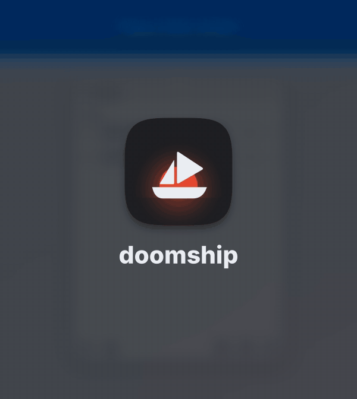
</p>

<p align="center"><sub>
  New: copy a colour and Encore shows it. Recorded straight from the app by
  <a href="https://github.com/sudonicolas/doomship">doomship</a>.
</sub></p>

<p align="center">
  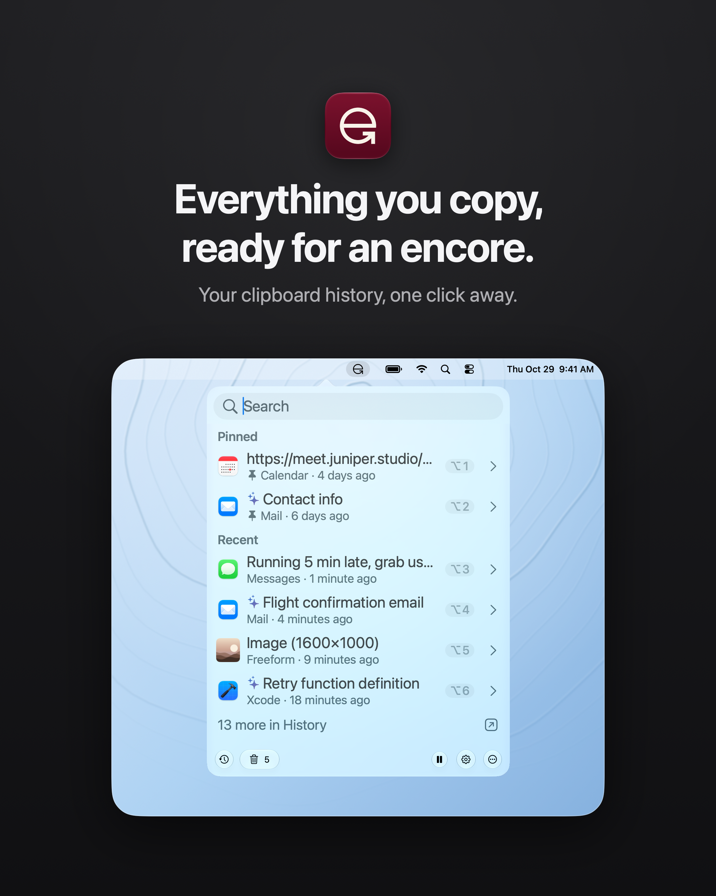
</p>

## Screenshots

<p align="center">
  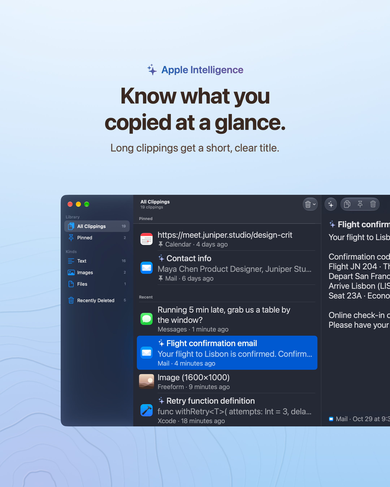
  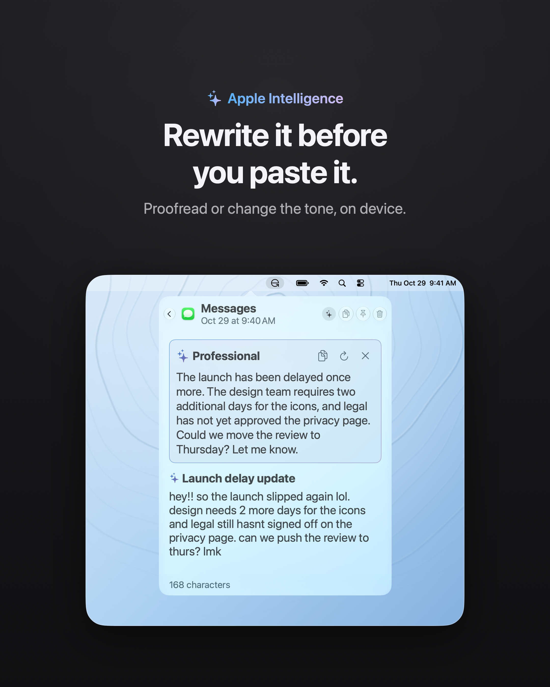
</p>

<p align="center">
  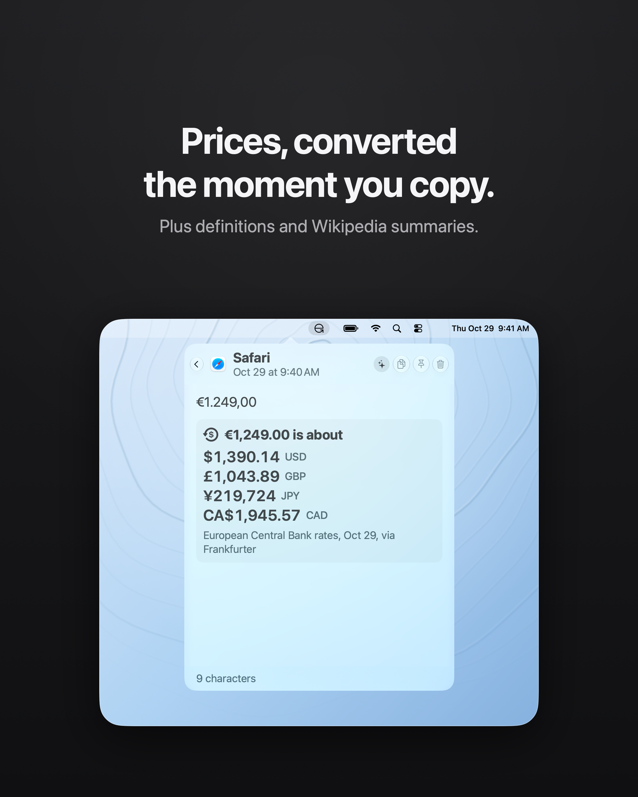
  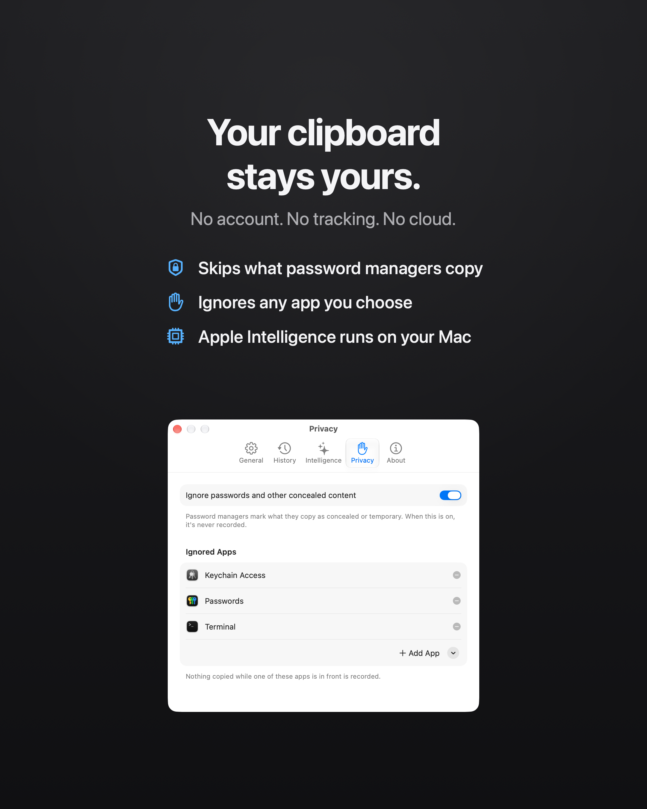
</p>

<p align="center">
  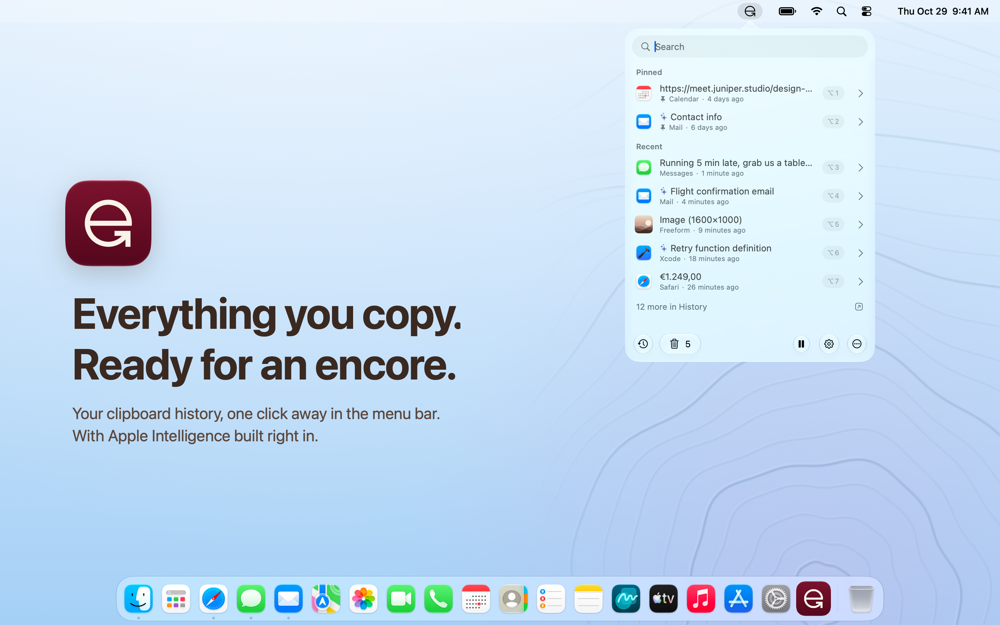
</p>

<p align="center">
  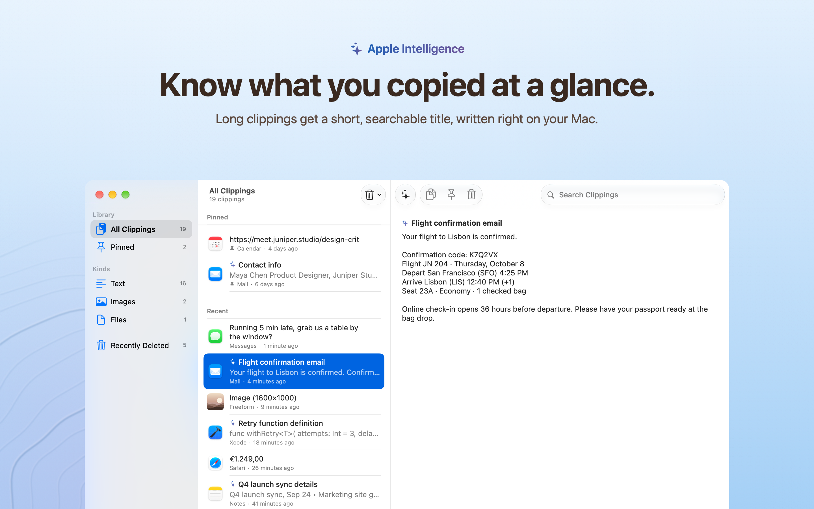
  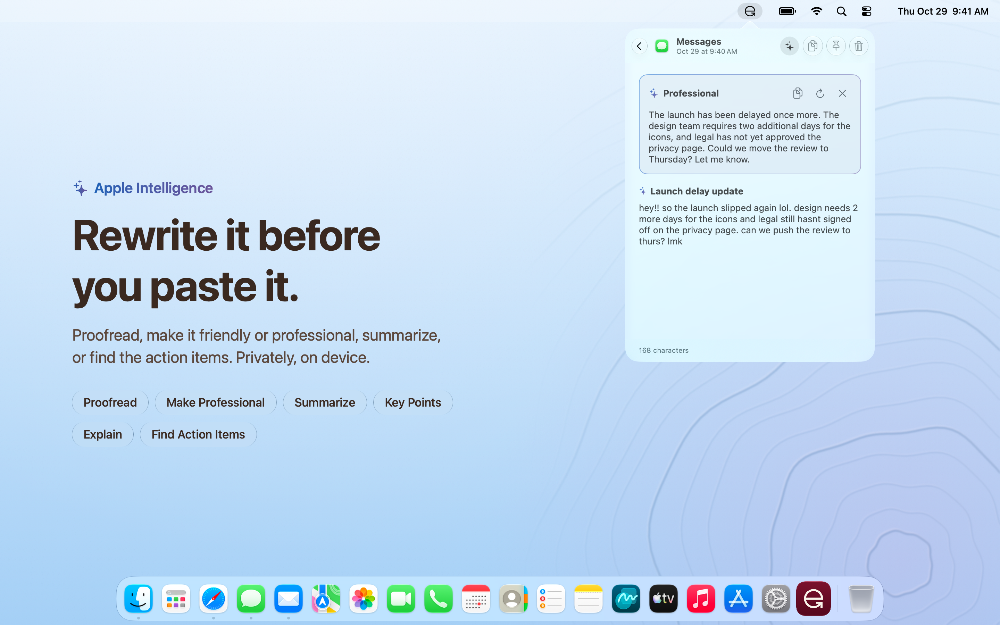
</p>

<p align="center">
  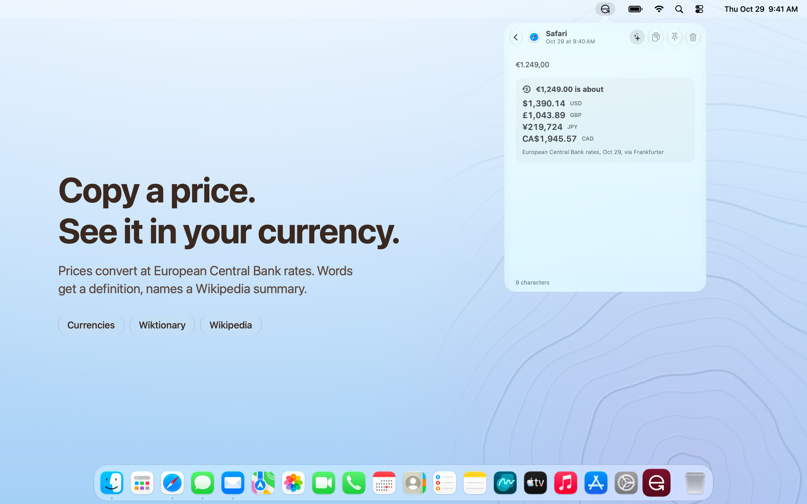
  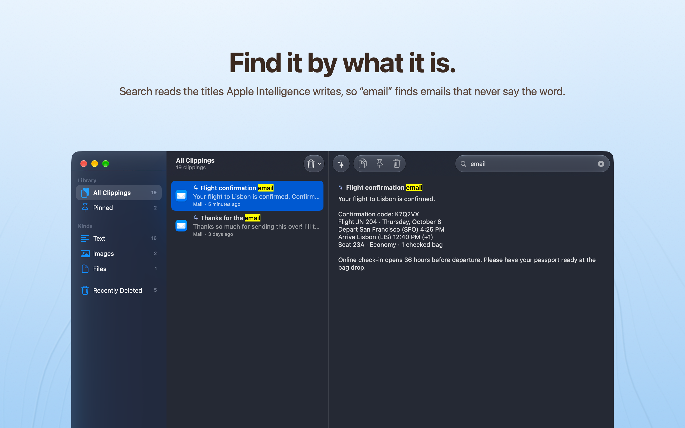
</p>

<p align="center">
  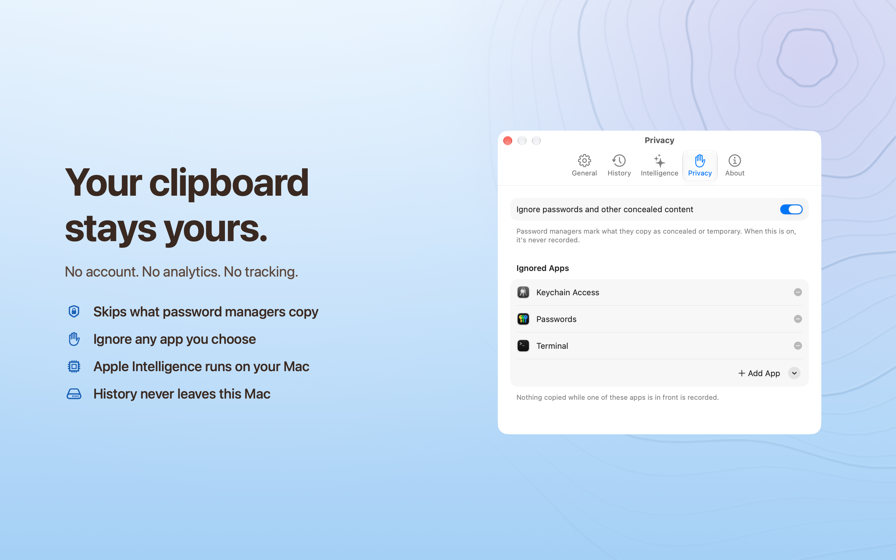
  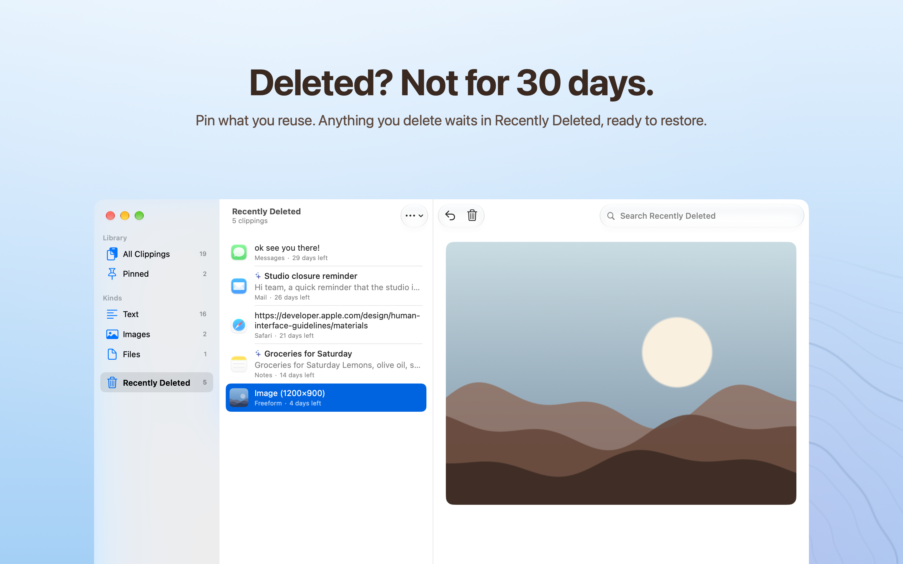
</p>

## Features

**Clipboard history**
- **Menu bar popover.** Click the icon for a searchable list of recent clippings. Click a
  row to copy it; the chevron opens the full clipping. Right-click the icon for a classic menu.
- **History window.** Sidebar (All, Pinned, Text, Images, Files, Recently Deleted), list and
  detail, with search, multi-select, context menus, swipe actions and keyboard commands
  (Return copies, ⌫ deletes, ⌘C copies, ⌘Z undoes).
- **Pin** what you reuse. Pinned clippings stay at the top and are never trimmed.
- **Recently Deleted.** Deleting is always recoverable for 30 days, with Undo right away.
- **No duplicates.** Copying something that's already in history moves it to the top.
- **Colour swatches.** Copy a hex colour (`#FF6B35`, `#fc0`, or `#6C5CE7CC` with alpha)
  and its row shows the colour itself, in the popover and in History.

**Apple Intelligence** (on device, requires an Apple Intelligence–capable Mac)
- **Smart titles.** Long clippings get a two-to-six-word title ("Flight confirmation email",
  "Python retry decorator"), written in the clipping's own language, so a long list can be
  scanned at a glance. Titles are searchable too.
- **Writing tools for any clipping.** The ✨ menu can *Proofread*, *Make Friendly*,
  *Make Professional* or *Make Concise*, and can *Summarize*, list *Key Points*, *Explain*
  (including code) or *Find Action Items*. Results stream in and can be copied with one click.

**Online lookups** (free services, no API keys)
- **Currency conversion.** Copy "$1,299.99", "€49,90" or "250 CHF" and see it in your own
  currency and other major ones, at European Central Bank rates via
  [Frankfurter](https://frankfurter.dev).
- **Definitions** from [Wiktionary](https://en.wiktionary.org) for a single word.
- **Encyclopedia summaries** from [Wikipedia](https://en.wikipedia.org) for a name or topic.

**Accessibility**
- **VoiceOver**: each clipping reads as one item with Copy, Pin, Show Details and Delete
  as actions; results are announced, and rotors jump to pinned clippings, images and files.
- **Voice Control**: every button has a speakable name.
- **Keyboard**: ⇧⌘V opens the popover from any app; ↑ and ↓ in the popover, Return to
  copy, ⌘↓ to open a clipping.
- **Text Size** up to 200% (Settings → General, or ⌘+ and ⌘−).
- Follows Reduce Motion, Increase Contrast and Differentiate Without Color, with colours
  that meet Apple's contrast minimums.

## Privacy

Encore is built so your clipboard stays yours:

- History is stored only on your Mac, inside Encore's sandbox container
  (`~/Library/Containers/io.github.sudonicolas.encore/`). No account, no analytics, no
  crash reporting, no tracking: Encore collects no data at all.
- Apple Intelligence runs **entirely on device**. No clipping is ever sent to a server for
  titles or writing tools.
- Online lookups send **only what's needed, and only when needed**: a word or phrase goes to
  Wiktionary or Wikipedia only when you click *Define* or *Wikipedia*; exchange rates are
  fetched with just the currency code (never the amount or anything else you copied).
  Requests carry no cookies or identifiers. Lookups can be turned off in
  Settings → Intelligence.
- Anything password managers mark as concealed is never recorded, and you can exclude
  whole apps in Settings → Privacy.

The full policy is in [PRIVACY.md](PRIVACY.md).

## Requirements

- macOS 26 or later. Tested on macOS 27.
- For Apple Intelligence features: a Mac that supports Apple Intelligence, with it turned
  on in System Settings → Apple Intelligence & Siri. Everything else works on any Mac.

## Install

### Download

1. Download **Encore.dmg** from [nicolasx.com](https://nicolasx.com) or
   [Releases](https://github.com/sudonicolas/Encore/releases) and double-click it. A window opens with the Encore icon and an Applications folder.
2. **Drag Encore onto Applications.** That copies the app to your Mac.
3. Close the window, then eject the disk image: click the eject button next to **Encore**
   in the Finder sidebar, or drag it to the Trash. You can delete the downloaded
   `Encore.dmg` too.
4. Open **Encore** from Applications (or Spotlight, ⌘ Space). It has no Dock icon: look for
   the Encore mark in the menu bar, at the top right of the screen.
5. Encore asks to read what other apps copy. Choose **Allow**; it can't record anything
   otherwise (see *Clipboard permission* below).

**First time opening it.** Encore isn't notarized by Apple yet, so macOS may say it can't
verify the app. That's expected, and it only happens once:

1. Click **Done** (not *Move to Trash*).
2. Open **System Settings → Privacy & Security** and scroll down to the message about
   Encore.
3. Click **Open Anyway**, then enter your password or use Touch ID.
4. Open Encore again and click **Open**.

To start Encore when you log in, open its menu bar icon, choose Settings and turn on
*Open at login*. This works once Encore is in Applications, not while it is still running
from the disk image.

### Build from source

Requires Xcode 26 or later.

```sh
git clone https://github.com/sudonicolas/encore.git
cd encore
./build.sh
ditto build/Encore.app /Applications/Encore.app
open /Applications/Encore.app
```

`build.sh` compiles a universal (Apple silicon and Intel) release build, assembles
`Encore.app` (with `LSUIElement` set, so it lives in the menu bar and not the Dock),
compiles the icon with `actool`, and signs the bundle with the same App Sandbox
entitlements as the store build. It signs with your Apple Development certificate if you
have one, so macOS doesn't ask about access to Encore's data after every rebuild, and
ad-hoc otherwise. For *Open at login* to work reliably, run Encore from a
stable location such as `/Applications`.

For quick iteration, `swift build` and `swift run` work too. They run the bare executable
rather than an app bundle, so there's no icon, no Dock hiding, no login item and no
sandbox. They also read and write `~/Library/Application Support/Encore/` instead of the
container, so they start with an empty history.

### Disk image for download

`./build.sh --dmg` builds the same app and packs it into `build/Encore.dmg`, the
drag-to-install image described above. `tools/make-dmg.sh` lays out the window and
`tools/dmg/make-background.py` draws its backdrop. Laying out the window drives Finder with
AppleScript, so the first run asks for permission to control it.

Without a Developer ID certificate, the image holds an ad-hoc signed app and its backdrop
carries the *Open Anyway* steps. To remove the warning for everyone, create a **Developer ID
Application** certificate with the same Apple Developer Program membership the App Store
build uses (Xcode → Settings → Accounts → Manage Certificates → +; only the account holder
can), make an app-specific password at [account.apple.com](https://account.apple.com), and
store notarization credentials once:

```sh
xcrun notarytool store-credentials encore-notary --apple-id you@example.com --team-id TEAMID
NOTARY_PROFILE=encore-notary ./build.sh --dmg
```

`build.sh` signs with the Developer ID certificate it finds, submits the image to Apple,
waits for the verdict and staples the ticket, so the image opens with no warning at all and
its backdrop drops the *Open Anyway* steps.

To publish it, attach it to a GitHub release under exactly the name `Encore.dmg`:
`https://github.com/sudonicolas/Encore/releases/latest/download/Encore.dmg` always serves the
newest one, and [nicolasx.com/Encore.dmg](https://nicolasx.com/Encore.dmg) redirects there.

```sh
gh release create v1.2.0 build/Encore.dmg --title "Encore 1.2.0" --notes "…"   # a new version
gh release upload v1.2.0 build/Encore.dmg --clobber                            # replace the file
```

### Mac App Store build

`./build.sh --app-store` signs for distribution and produces `build/Encore.pkg` for
upload. See [docs/APP_STORE.md](docs/APP_STORE.md) for the one-time account setup and the
submission checklist.

### Clipboard permission

macOS lets you choose whether apps may read what other apps copy. If you set Encore to
**Deny** in System Settings → Privacy & Security → Paste from Other Apps, Encore can't
record anything and shows a banner to say so. Choose **Allow**.

### Upgrading from "clipboard"

Encore used to be called *clipboard*. On first launch it quits the old app if it's
running, moves your history and ignored apps into Encore's folder, and carries over your
settings. After that you can delete `clipboard.app`, and if it was set to open at login,
remove it from System Settings → General → Login Items and turn on *Open at login* in
Encore's Settings instead.

## Project layout

```
Sources/Encore/
  EncoreApp.swift                  App entry point (app menu commands)
  AppDelegate.swift                Status item, popover, History window, activation policy
  SettingsWindowController.swift   Toolbar-tab Settings window
  Models/                          Clipping, IgnoredApp, pasteboard read/write
  Stores/                          ClipboardStore (history, settings, persistence), AppNavigator
  Managers/                        Pasteboard polling, launch at login, migration from "clipboard"
  Intelligence/                    Foundation Models: availability, smart titles, writing tools
  Lookups/                         Currency, word and topic detection; Frankfurter, Wiktionary
                                   and Wikipedia clients; lookup cards
  Views/                           Popover, History window, Recently Deleted, Settings panes
  Utilities/                       App info, brand and status colours, corner radii, thumbnails,
                                   highlighting, Text Size, accessibility helpers
Resources/AppIcon.icon             The app icon, an Icon Composer document
Resources/Assets.xcassets          The menu bar mark, as Encore's own SF Symbols
Resources/PrivacyInfo.xcprivacy    Privacy manifest (no tracking, no data collected)
Resources/container-migration.plist  Moves pre-sandbox data into the container
Encore.entitlements                App Sandbox entitlements
tools/make-dmg.sh                  Packs Encore.app into the drag-to-install disk image
tools/dmg/make-background.py       Draws the disk image's window backdrop
tools/export-icon-preview.sh       Renders the icon to docs/icon.png
tools/make-mark.py                 Draws the mark: icon artwork and menu bar symbols
```

The icon is the Encore mark — a true circular "e" whose lower arc runs on into a right-angle
arrowhead — in cream on bordeaux. It is built from the circle, so the crossbar, the arrow and the
gap between them all share one stroke and the ink box is an exact square.
Open `Resources/AppIcon.icon` in Icon Composer (bundled with Xcode) to edit it; macOS
renders it live in light, dark, clear and tinted appearances (the mark is flat, not glass). The menu bar uses the same
mark as Encore's own SF Symbol (`encore.mark`, and `encore.mark.fill` for the copy flash).
Both the icon artwork and the symbols come from `tools/make-mark.py`, and the symbols are
compiled into the app's `Assets.car` beside the icon. See [`docs/COLOR.md`](docs/COLOR.md).

## Notes

- Clipboard changes are detected by polling `NSPasteboard.changeCount` twice a second, since
  macOS has no notification for pasteboard changes. This is the standard approach for
  clipboard managers.
- While the History or Settings window is open, Encore behaves like a regular app (Dock
  icon, ⌘Tab). It goes back to menu bar only when they close.
- Sandboxed, with only outgoing network access (for online lookups) and read-only access
  to apps you choose in Settings → Privacy. Builds from before sandboxing kept their data
  in `~/Library/Application Support/Encore/`; `Resources/container-migration.plist` makes
  macOS move it into the container on first launch.

## License

[MIT](LICENSE) © 2026 sudonicolas
